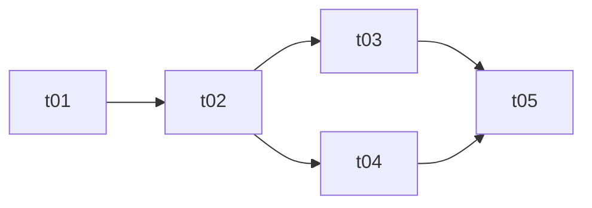

# Task Breakdown (拆卡)

The job is to produce **cards** (`docs/tasks/`) and a **tracker** (`docs/TASK.md`). A card is one verifiable piece of work; the tracker shows what is done and how cards depend on each other. The layout is fixed so the user and later sessions always know where to look — keep these exact names rather than inventing variants.

```
docs/
├── TASK.md            # tracker: status table + dependency graph
├── tasks/
│   ├── t01-init-project.md
│   └── t02-code-base.md
├── SPEC.md            # optional — read it if it exists
└── ARCHITECTURE.md    # optional — read it if it exists
```

## Naming rules
These are the details that drift between sessions, so follow them literally:
- Card file: `t` + **two-digit, unique, increasing number** + `-` + short kebab-case description, e.g. `t01-init-project.md`.
- Description is 2–4 words, lowercase English, names the feature/outcome (not "misc", "fix").
- Directory is `docs/tasks/` (plural); tracker is `docs/TASK.md` (singular, uppercase); the optional architecture file is spelled `ARCHITECTURE.md`.
- Don't reuse or renumber numbers: other cards, the graph and commit messages refer to them. New cards get the next number.
- If any of these files already exist, read and extend them; don't overwrite or rename.
- Write card bodies and the tracker in the user's language (file names stay English).

## Precondition: input from the user
Cards are only as good as what they are cut from, and what to build is the user's call, not yours. So before anything else, check that the user supplied at least one of:
- a description of what to build or change (in the message or earlier in the conversation);
- documents or files to work from (PRD, SPEC, design notes, an existing `docs/` or code they point to).

If they gave **neither**, stop. Don't scan the repo and guess a project from it, don't invent requirements, and don't write placeholder cards — they would look like a plan and be wrong. Reply briefly asking for one of the two, e.g. "拆卡需要依据：请告诉我要做什么，或指定要参考的文档/目录。" If the repo contains likely candidates (a `docs/SPEC.md`, a README), name them and ask whether to use them rather than assuming.

If the input is too thin to cut cards without making up the core of the product (what it does, who it is for, what "done" looks like), ask the few questions that unblock it. Small gaps (tech stack, naming, minor scope) you may fill with assumptions — state them in the cards' `背景`, so the user can correct them.

## Workflow: creating a breakdown
1. Read everything the user gave you, plus `CLAUDE.md`/`AGENTS.md`, README and the code that is relevant to it. Treat what you find as supplementary to the user's input, not a replacement for it.
2. Split the work into cards. Each card should be:
   - one coherent, verifiable deliverable, small enough for a single session;
   - **as independent as practical** — aim for a card that a fresh session can pick up and finish using only the card itself plus the code already in the repo. Independence is a goal, not a rule: some cards genuinely build on others, and forcing it (duplicated work, fake stubs) is worse than an honest dependency. When a dependency is real, declare it; when two cards could be made independent cheaply (agree on an interface up front, split along a seam), do that so they can run in parallel;
   - dependent only on earlier cards (no cycles), listing **direct** dependencies only — the graph implies the rest.
3. Make each card self-sufficient: put the context a fresh session needs in the card instead of assuming the reader saw this conversation, and point to existing docs/files by path. Don't repeat project-wide conventions in every card; if they aren't written down anywhere, have the first card (usually t01) record them in `ARCHITECTURE.md` or `CLAUDE.md` and let later cards link there. Don't create SPEC/ARCHITECTURE just for the sake of it.
4. List the files each card touches. This is how parallel cards avoid colliding: if two cards that could run at the same time touch the same file, add a dependency, move the shared piece into an earlier card, or write the agreed interface into both cards.
5. Write each card `docs/tasks/tNN-xxx.md` (template below), then `docs/TASK.md`. Every card file must appear in the tracker and vice versa.
6. Finish by listing the cards and which are ready to start (all dependencies done). Don't start implementing unless asked.

## Card template
Keep cards short — as long as it takes for a fresh session to start and to know when it's done, no longer. Drop a section that has nothing to say, except `明确不做`: write "无" rather than deleting it, because that boundary is what keeps cards independent.

````markdown
# tNN · <Title>

## 元信息
- 依赖：t01 · t02                 <!-- direct dependencies, or "无" -->
- 触碰文件：`path/a`、`path/b/`    <!-- what this card creates or edits -->

## 背景
Why this card exists, what is already in place, decisions not to re-litigate.

## 必读
- `docs/ARCHITECTURE.md#section` — why it matters
- `path/to/existing/file` — the pattern to copy

## 范围
- [ ] Concrete deliverable (file / interface / behaviour)

## 明确不做
- What belongs to another card (tMM) or was deliberately rejected

## 验收标准
- Commands that must pass, or observable behaviour someone else could check
````

If a check can only be done by hand or can't run in the current environment, say so in the card, and when closing the card say honestly what was and wasn't verified.

## TASK.md template
For a long plan, group the tables under phase headings (`## 阶段 01 · …`); for a small one a single table is enough.

````markdown
# 任务总表

状态：`⬜ 未开始` / `🔄 进行中` / `✅ 完成`

## 依赖图


## 任务
| 编号 | 标题 | 依赖 | 状态 |
|---|---|---|---|
| t01 | [项目脚手架](tasks/t01-init-project.md) | — | ⬜ |
| t02 | [代码基础](tasks/t02-code-base.md) | t01 | ⬜ |
````

Keep the table, the graph, and each card's `依赖` consistent.

## Workflow: working a card / updating progress
Before starting a card, check in `TASK.md` that all its dependencies are ✅; if not, say so and either stop or pick a ready card. Mark it 🔄 while working.

When you finish a card (acceptance criteria verified, not merely code written), tick its `范围` boxes and set its status to ✅ in `TASK.md`. If criteria are unmet, leave it 🔄 and note what's left — a falsely ticked card makes every dependent card start on a broken base.

## Adding cards later
Append a card with the next number, add it to the table and graph, and fix the `依赖` of any card it affects.
