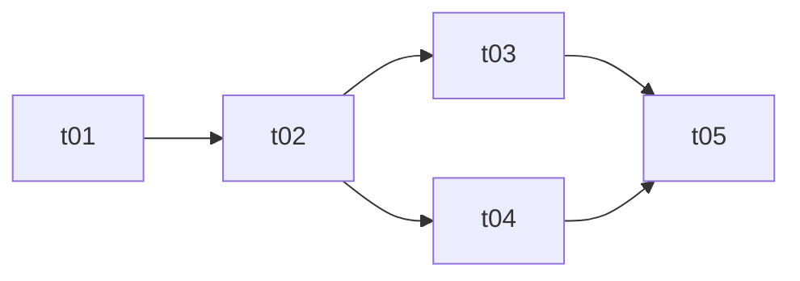

# Task Breakdown (拆卡)

The job is to produce **cards** (`docs/tasks/`) and a **tracker** (`docs/TASK.md`). A card is one verifiable piece of work; the tracker holds the whole plan, progress and history in one place. The layout is fixed so the user and later sessions always know where to look — keep these exact names and locations rather than inventing variants.

```
docs/
├── TASK.md            # tracker: phase tables + dependency graph + change log (single source of truth for progress)
├── tasks/
│   ├── t01-init-project.md
│   └── t02-code-base.md
├── SPEC.md            # optional, what to build — read it if it exists
└── ARCHITECTURE.md    # optional, how it is built — read it if it exists
```

## Naming rules
These are the details that drift between sessions, so follow them literally:
- Card file: `t` + **two-digit, unique, increasing number** + `-` + short kebab-case description, e.g. `t01-init-project.md`. Past 99 cards the number just grows to three digits (`t100-…`).
- Description is 2–4 words, lowercase English, names the feature/outcome (not "misc", "fix").
- Directory is `docs/tasks/` (plural); tracker is `docs/TASK.md` (singular, uppercase); the optional architecture file is spelled `ARCHITECTURE.md`.
- Numbers are not reused. Gaps are fine. Once a card is started or done, never renumber it: other cards, the graph and commit messages refer to it. Append new cards instead.
- If any of these files already exist, read and extend them; don't overwrite or rename.
- Write card bodies and the tracker in the user's language (file names stay English).

## Workflow: creating a breakdown
1. Read the user's idea and any existing `docs/`, `CLAUDE.md`/`AGENTS.md`, README and code. If requirements are ambiguous in a way that changes the card structure, ask a few focused questions first; otherwise proceed with stated assumptions.
2. Group the work into **phases** (foundation → backend/core → features → polish/release, or whatever fits), then split each phase into cards. Each card should be:
   - one coherent, verifiable deliverable, small enough for a single session;
   - **as independent as practical** — aim for a card that a fresh session can pick up and finish using only the card itself plus the code already in the repo. Independence is a goal, not a rule: some cards genuinely build on others, and forcing it (duplicated work, fake stubs) is worse than an honest dependency. When a dependency is real, declare it; when two cards could be made independent cheaply (agree on an interface up front, split along a seam), do that so they can run in parallel;
   - dependent only on earlier cards (no cycles). List **direct** dependencies only; the graph already implies the rest.
3. Make each card self-sufficient. Put the context a fresh session needs in the card (`背景`, `必读`) instead of assuming the reader saw this conversation. Point to existing docs by path and section. Don't repeat project-wide conventions in every card: if they aren't written down anywhere, make the first card (usually t01) record them in `ARCHITECTURE.md` or `CLAUDE.md`, and let later cards link there. Create SPEC/ARCHITECTURE only if the user asks or a convention needs a home.
4. Declare **`触碰文件`** for every card (files/dirs it creates or edits). This is how parallel cards avoid colliding: if two cards that could run at the same time touch the same file, either add a dependency, move the shared piece into an earlier card, or write the agreed interface into both cards.
5. Write each card `docs/tasks/tNN-xxx.md` with the card template below, then `docs/TASK.md` with the tracker template. Every card file must appear in the tracker and vice versa.
6. Finish by listing the cards and which are ready to start (all dependencies done). Don't start implementing unless asked.

## Card template
Keep it as short as the card allows. Drop a section that has nothing to say, except `明确不做`: write "无" there rather than deleting it, because the boundary is what keeps cards independent.

````markdown
# tNN · <Title>

## 1. 元信息
- 依赖：t01 · t02                 <!-- direct dependencies, or "无" -->
- 触碰文件：`path/a`、`path/b/`    <!-- what this card creates or edits -->
- 模型：sonnet                     <!-- optional: only if the project routes cards to different models -->

## 2. 背景
Why this card exists, what is already in place, decisions the implementer must not re-litigate. Enough for a fresh session to start.

## 3. 必读
- `docs/ARCHITECTURE.md#section` — why it matters
- `path/to/existing/file` — the pattern to copy

## 4. 范围
- [ ] Concrete deliverable (file / interface / behaviour)
- [ ] ...

## 5. 明确不做
- What belongs to another card (tMM) or was deliberately rejected

## 6. 实现约定
- Constraints specific to this card (naming, libraries, migrations, error handling)

## 7. 验收标准
可执行：
```bash
<commands that must pass, e.g. typecheck / test / curl>
```
行为：
- Observable result, stated so someone else could check it
````

If a check can only be done by hand or can't run in the current environment (e.g. no browser), say so in the card, and when closing the card record honestly what was and wasn't verified. Add a `设计稿来源` section only for UI cards that have a design source.

## TASK.md template
````markdown
# 任务总表

状态：`⬜ 未开始` / `🔄 进行中` / `✅ 完成`

## 依赖图


## 阶段 00 · 地基
| 编号 | 标题 | 依赖 | 状态 |
|---|---|---|---|
| t01 | [项目脚手架](tasks/t01-init-project.md) | — | ⬜ |
| t02 | [代码基础](tasks/t02-code-base.md) | t01 | ⬜ |

## 阶段 01 · 功能
| 编号 | 标题 | 依赖 | 状态 |
|---|---|---|---|
| t03 | [...](tasks/t03-xxx.md) | t02 | ⬜ |

## 变更记录
| 日期 | 卡号 | 结果 |
|---|---|---|
````

Keep the tables, the graph, and each card's `依赖` consistent. A phase added later can carry its date and a short paragraph on why it exists — useful when the plan grows over weeks.

## Workflow: working a card / updating progress
Before starting a card, check in `TASK.md` that all its dependencies are ✅; if not, say so and either stop or pick a ready card. Mark it 🔄 while working.

When you finish a card (acceptance criteria verified, not merely code written):
1. Tick its `范围` boxes in the card file.
2. In `docs/TASK.md` set its status to ✅.
3. Add a row at the top of `变更记录`: date, card number, and what was actually delivered — including files touched beyond `触碰文件`, deviations, and anything not verified. This is the record the next session reads, so be specific and honest.
4. If criteria are unmet, leave it 🔄 and note what's left. A falsely ticked card makes every dependent card start on a broken base.

If the project assigns roles (e.g. implementer sub-agents and a main session), follow its rule for who edits `TASK.md`; by default only one party does, so edits don't conflict.

## Changing the plan mid-way
- New work: append a card with the next number (in an existing phase or a new dated phase), add it to the table and graph.
- Cards not yet started may be reworked or reordered; say so in `变更记录`. Started or done cards keep their number.
- Dropped work: keep the row, mark it `❌ 取消（原因）` rather than deleting, so numbering and history stay readable.
- If SPEC/ARCHITECTURE exist and change, update them in the same change and fix affected cards' `背景`/`必读`.
