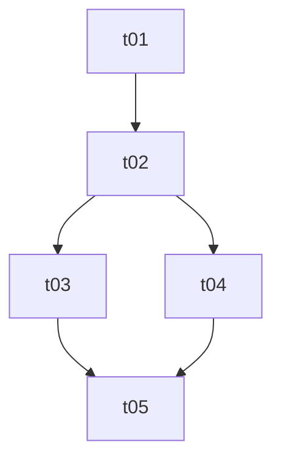

# Task Breakdown (拆卡)

Cards let an agent work on one small, verifiable piece at a time while `docs/TASK.md` keeps the whole plan and progress in one place. The layout is fixed so the user (and later sessions) always know where to look — keep these exact names and locations rather than inventing variants.

```
docs/
├── SPEC.md            # what to build: goals, scope, non-goals, requirements, acceptance
├── ARCHITECTURE.md    # how: tech stack, modules, data flow, key decisions
├── TASK.md            # tracker: status checklist + dependency graph (single source of truth for progress)
└── tasks/
    ├── t01-init-project.md
    ├── t02-code-base.md
    └── t03-xxx.md
```

## Naming rules
These are the details that drift between sessions, so follow them literally:
- Card file: `t` + **two-digit, unique, sequential number** + `-` + short kebab-case description, e.g. `t01-init-project.md`. Numbers are never reused or renumbered because other cards, the graph and commit messages refer to them; append new cards instead.
- Description is 2–4 words, lowercase English, describes the feature/outcome (not "misc", "fix").
- Directory is `docs/tasks/` (plural); tracker is `docs/TASK.md` (singular, uppercase); the architecture file is spelled `ARCHITECTURE.md`.
- If any of these files already exist, read and extend them; don't overwrite or rename.

## Workflow: creating a breakdown
1. Read the user's idea and any existing `docs/`, README, code. If requirements are ambiguous in a way that changes the card structure, ask a few focused questions first; otherwise proceed with stated assumptions.
2. Write `docs/SPEC.md` and `docs/ARCHITECTURE.md` (concise; enough for a card to reference). Skip if the user only asked for tasks and these exist.
3. Split work into cards, each:
   - one coherent, independently verifiable deliverable (roughly ≤ half a day of agent work);
   - ordered so t01 is project init/scaffold, then shared foundation, then features, then polish/release;
   - with explicit dependencies on earlier cards only (no cycles).
4. Write each card `docs/tasks/tNN-xxx.md` using the card template below.
5. Write `docs/TASK.md` using the tracker template below. Every card file must appear in it and vice versa.
6. Finish by listing the cards and the first card(s) ready to start. Do not start implementing unless asked.

## Card template
```markdown
# tNN — <Title>

- Status: todo            <!-- todo | doing | done -->
- Depends on: t01, t02    <!-- or "none" -->

## Goal
One or two sentences: what is true when this card is done.

## Scope
- What to do (concrete steps / files / interfaces)

## Out of scope
- What NOT to do here (belongs to another card: tMM)

## Acceptance criteria
- [ ] Verifiable check (command to run, behavior to observe)
- [ ] ...

## Notes
Links to SPEC.md / ARCHITECTURE.md sections, risks, decisions.
```

## TASK.md template
```markdown
# Tasks

Progress: 0 / N done

## Checklist
- [ ] [t01 init-project](tasks/t01-init-project.md) — one-line summary
- [ ] [t02 code-base](tasks/t02-code-base.md) — one-line summary (needs: t01)

## Dependency graph

```
Keep the checklist, the graph, and each card's `Depends on` consistent.

## Workflow: working a card / updating progress
When you finish a card (acceptance criteria all verified, not merely code written):
1. Tick its acceptance criteria and set `Status: done` in the card file.
2. In `docs/TASK.md` change `- [ ]` to `- [x]` for that card and update the `Progress: X / N` line.
3. Optionally mark done nodes in the graph (e.g. `t01:::done` with `classDef done fill:#cfc;`).
4. If criteria are unmet, set `doing` and note what's left — a falsely ticked card makes every dependent card start on a broken base.
Before starting a card, check in `TASK.md` that all its dependencies are `[x]`; if not, say so and stop or pick a ready card.

## Changing the plan mid-way
- New work: append a new card with the next number, add it to the checklist and graph.
- Dropped work: mark `- [~] ... (cancelled: reason)` rather than deleting, and keep the numbering.
- If SPEC/ARCHITECTURE change, update those docs in the same change and fix affected cards.
